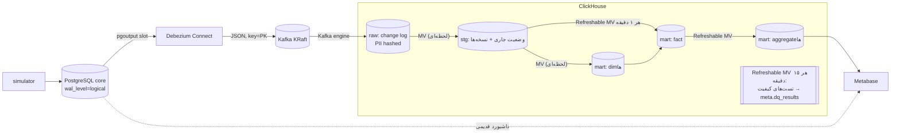
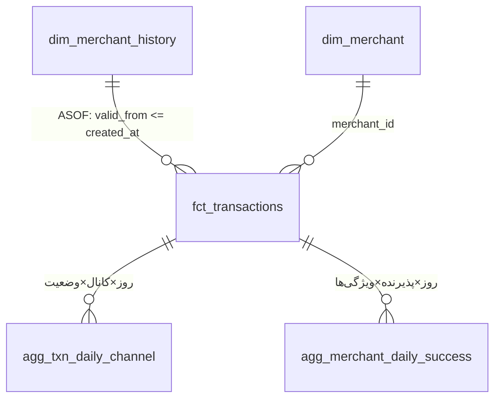

# پرداخت‌یار — پلتفرم داده تحلیلی (آزمون Senior Data Engineer)

PostgreSQL (core) ← **Debezium** ← **Kafka** ← **ClickHouse** ← **Metabase**

لایه‌های raw → stg → mart، زمان‌بندی و تست‌های کیفیت داده **همه داخل خود ClickHouse** اجرا می‌شوند و به هیچ ابزار تبدیل یا زمان‌بند جداگانه‌ای نیاز نیست.

## ۱. اجرا و تست

پیش‌نیاز: Docker با Compose v2. حدود ۸ گیگابایت RAM برای Docker کافی است و به هیچ سرویس ابری یا پولی نیاز نیست.

```bash
docker compose up -d --build
```

همین یک دستور این کارها را انجام می‌دهد:

1. ساخت و پرکردن core با ۵ میلیون تراکنش (۱ تا ۳ دقیقه)
2. Snapshot اولیه CDC و شروع ارسال تغییرات بعدی
3. اجرای شبیه‌ساز و تبدیل‌های داخل ClickHouse
4. ساخت سه داشبورد در Metabase: «فروش روزانه» روی core، نسخهٔ بهینه روی ClickHouse، و «کیفیت داده»
5. پس از رسیدن پایپ‌لاین به core: بنچمارک کارت‌ها و مقایسهٔ نتایج در `docs/results/benchmark.md`

| کار | دستور |
|---|---|
| تغییر Schema (افزودن `installments`) | `docker compose exec simulator python schema_change.py` |
| همهٔ تست‌های کیفیت داده: کلید، مقادیر مجاز، PII، مالک، point-in-time، سازگاری، تطبیق با core، freshness | `docker compose exec clickhouse bash /scripts/run_tests.sh` |
| تست سرتاسری CDC (ترتیب، Update/Delete، تاریخچه، installments) | `docker compose run --rm ops python e2e_cdc_test.py` |
| بنچمارک و مقایسه دوباره | `docker compose run --rm ops python benchmark.py` |
| وضعیت مراحل تبدیل در ClickHouse | `SELECT view, status, last_success_time, exception FROM system.view_refreshes` |

آدرس‌ها:

- Metabase: `localhost:3000` با `admin@payyar.local` / `Payyar-admin-2026`
- Postgres: `localhost:15432`
- ClickHouse: `localhost:18123/play`
- Kafka Connect: `localhost:8083`

همه رمزها مقدار تستی‌اند و در `.env` هستند. جزئیات اتصال و سناریوهای تست در [docs/testing.md](docs/testing.md) آمده است.

## ۲. دادهٔ اولیه و شبیه‌ساز

**دادهٔ اولیه** ([02_seed.sh](source/postgres/init/02_seed.sh)) کاملاً داخل Postgres و با `generate_series` و `setseed` ساخته می‌شود، پس سریع و تکرارپذیر است:

- ۲٬۰۰۰ پذیرنده در ۱۰ صنف و ۳۱ استان، با ریسک LOW/MEDIUM/HIGH به نسبت ۷۰ / ۲۲ / ۸ درصد
- ۵٬۰۰۰٬۰۰۰ تراکنش در ۱۸۰ روز، با شناسه‌هایی که با زمان زیاد می‌شوند
- چند پذیرندهٔ پرتراکنش و تعداد زیادی کم‌تراکنش
- کانال POS/IPG/QR به نسبت ۶۰ / ۳۰ / ۱۰ درصد
- وضعیت SUCCESS/FAILED/REVERSED به نسبت ۸۰ / ۱۰ / ۱۰ درصد
- مبلغ با توزیع log-normal

فقط ایندکس‌هایی ساخته می‌شوند که یک سیستم عملیاتی واقعاً دارد: PK، FK و `created_at`.

**شبیه‌ساز** ([simulator.py](tools/simulator.py)) این تغییرات را مداوم روی core اعمال می‌کند:

- هر ثانیه حدود ۲۰ تراکنش PENDING درج می‌کند که بعد از ۲ تا ۸ ثانیه SUCCESS یا FAILED می‌شوند.
- حدود ۱۱ درصد تراکنش‌های موفق بعد از ۳۰ تا ۲۴۰ ثانیه REVERSED می‌شوند.
- هر دقیقه `risk_level` و `province` یک پذیرنده عوض می‌شود.
- هر ۳۰ ثانیه چند تراکنش آزمایشی با BIN `999999` درج و بعد از ۵ تا ۲۰ ثانیه hard delete می‌شود.
- بعد از تغییر Schema، تراکنش‌های جدید ستون `installments` را هم پر می‌کنند.

## ۳. معماری و دلیل انتخاب‌ها ([جزئیات و گزینه‌های رد شده](docs/architecture.md))



| لایه | انتخاب | دلیل اصلی | گزینه‌های بررسی‌شده |
|---|---|---|---|
| CDC | Debezium روی Kafka Connect با pgoutput | استاندارد صنعت. snapshot و stream یکپارچه، ترتیب تغییرات هر کلید حفظ می‌شود و LSN در خود رویداد هست. | ClickHouse `MaterializedPostgreSQL` (آزمایشی و بدون تاریخچه)، Airbyte (سنگین، micro-batch) |
| انتقال | Kafka 4 (KRaft، یک نود) | بافر و replay، جداسازی تولیدکننده و مصرف‌کننده، بدون ZooKeeper | Redpanda، Debezium Server (بدون بافر بادوام) |
| ذخیره و پردازش | ClickHouse 25.8 LTS | ستونی و سریع برای کارت‌های تجمیعی. مصرف مستقیم Kafka، `ReplacingMergeTree` برای upsert/delete و `ASOF JOIN` برای point-in-time | Postgres جداگانه یا DuckDB (برای stream و دسترسی هم‌زمان ضعیف‌تر) |
| تبدیل و زمان‌بندی | **Materialized View و Refreshable MV خود ClickHouse** | منطق، زمان‌بندی و تست‌ها همه SQL و در یک سیستم‌اند. هیچ سرویس یا RAM اضافه‌ای لازم نیست. stg لحظه‌ای است و mart حدود ۱ دقیقه تأخیر دارد. | dbt (یک ابزار اضافه)، Airflow یا Dagster (حدود ۲ گیگ RAM و چند سرویس برای یک job یک‌دقیقه‌ای)، حلقهٔ Python |
| BI | Metabase 0.58 LTS با درایور داخلی ClickHouse | خواستهٔ مسئله | — |

## ۴. قواعد لایه‌ها ([جزئیات](docs/data-model.md))

| لایه | ساخته‌شده با | مجاز | غیرمجاز |
|---|---|---|---|
| **raw** | MV روی Kafka engine | فقط append هر رویداد CDC همراه `_op`، `_lsn`، `_source_ts_ms` و payload کامل. **PII همین‌جا hash می‌شود.** | update، delete یا منطق کسب‌وکاری |
| **stg** | MV معمولی (لحظه‌ای) | فقط تبدیل نوع. وضعیت جاری هر رکورد با `ReplacingMergeTree(_lsn, _is_deleted)` و همهٔ نسخه‌های پذیرنده. | join و تجمیع، تا خطای تبدیل هیچ‌وقت مصرف از Kafka را متوقف نکند |
| **mart** | MV برای dimها، Refreshable MV برای fact و aggregate | مدل ستاره‌ای، ویژگی‌های point-in-time و جدول‌های تجمیعی. تنها لایه‌ای که Metabase می‌بیند. | PII خام، یا دسترسی Metabase به raw و stg |

- **پردازش incremental**:
  - stg ذاتاً incremental است، چون MV فقط blockهای تازه را پردازش می‌کند.
  - Refreshable MV مربوط به fact در حالت `APPEND` watermark را از جدول مقصد خودش می‌خواند و فقط تراکنش‌های تغییرکرده را دوباره حساب می‌کند. تراکنش‌هایی که تغییر پذیرنده‌شان دیر رسیده هم دوباره حساب می‌شوند. ۵ دقیقه هم‌پوشانی دارد که idempotent است.
  - aggregateها فقط روزهای تغییرکرده را دوباره حساب می‌کنند. برای کلیدهایی که دیگر وجود ندارند، ردیف حذف می‌نویسند.
  - سه مرحلهٔ fact و aggregateها با `DEPENDS ON` در هر دقیقه به ترتیب اجرا می‌شوند و دو اجرای یک مرحله هیچ‌وقت هم‌زمان نمی‌شوند.
- **وضعیت جاری صحیح**: نسخه با LSN بالاتر برنده است، پس پیام تکراری یا خارج از ترتیب حالت جدیدتر را بازنویسی نمی‌کند. Delete با `_is_deleted` و `FINAL` اعمال می‌شود. `REPLICA IDENTITY FULL` باعث می‌شود رکورد حذف‌شده هم روز خودش را داشته باشد.
- **PII**: کد ملی و موبایل در اولین نقطهٔ ورود به ClickHouse با SHA-256 کلیددار hash می‌شوند. کلید در `secure.pii_key` است و فقط admin آن را می‌بیند. موبایل فقط به شکل mask‌شده مثل `0912****567` نمایش داده می‌شود و مقدار خام از payload هم حذف می‌شود.
- **مالک و ستون‌های حساس**: در `COMMENT` هر جدول و ستون ثبت شده‌اند (`owner=…; steward=…; grain=…; sensitive=…`). یک تست بررسی می‌کند که هیچ جدولی بدون owner نباشد.

## ۵. مدل تحلیلی و Grain



| جدول | Grain | دلیل |
|---|---|---|
| `fct_transactions` | یک ردیف برای هر تراکنش (وضعیت جاری) به‌همراه `mcc/province/risk_level_at_txn` | پایه همهٔ کارت‌ها و کوئری‌های ad-hoc. ویژگی‌های زمان تراکنش یک بار ثابت می‌شوند. |
| `dim_merchant_history` | پذیرنده × نسخه (LSN)، با `valid_from`. نمای `dim_merchant_scd2` بازهٔ `[valid_from, valid_to)` را اضافه می‌کند. | تاریخچه‌ای که core نگه نمی‌دارد (SCD2) |
| `dim_merchant` | پذیرنده، وضعیت جاری (SCD1) | نام پذیرنده برای کارت ۳ |
| `agg_txn_daily_channel` | روز × کانال × وضعیت (حدود ۲ هزار ردیف) | کارت‌های ۱ و ۲ |
| `agg_merchant_daily_success` | روز × پذیرنده × ویژگی‌های زمان تراکنش، فقط تراکنش‌های موفق (حدود ۳۰۰ هزار ردیف) | کارت‌های ۳، ۴ و ۵ |

## ۶. زمان کارت‌ها: قبل و بعد

**اندازه‌گیری**: ۲۰۲۶-۱۰-۱۹ روی سرور لینوکسی Ubuntu 20.04، با ۵.۰۲ میلیون تراکنش.

- مقدار گزارش‌شده میانهٔ ۵ اجرا بعد از یک اجرای warm-up است و از `running_time` خود Metabase خوانده شده، بدون cache.
- برای این اجرا شبیه‌ساز متوقف بود و صبر شد تا پایپ‌لاین کامل به core برسد (حالت `--quiesce`).
- خروجی کامل در [docs/results/benchmark.md](docs/results/benchmark.md) است.

| کارت | قبل: core (ms) | بعد: ClickHouse (ms) | بهبود | نتیجه | کار انجام‌شده |
|---|---:|---:|---:|---|---|
| ۱. مبلغ و تعداد روزانهٔ موفق‌ها (۹۰ روز) | 2666 | 45 | ×۵۹ | **یکسان** | به‌جای اسکن حدود ۲ میلیون ردیف، تجمیع روزانهٔ از پیش محاسبه‌شده (`agg_txn_daily_channel`) خوانده می‌شود: کمتر از ۳۰۰ ردیف. |
| ۲. نرخ موفقیت روزانه به تفکیک کانال (۳۰ روز) | 1197 | 45 | ×۲۷ | **یکسان** | همان جدول. نرخ از شمارش هر وضعیت حساب می‌شود. |
| ۳. ده پذیرندهٔ برتر ماه جاری | 409 | 55 | ×۷ | **یکسان** | `agg_merchant_daily_success` (روز × پذیرنده) به‌علاوهٔ dim کوچک پذیرنده، به‌جای join با ۸۰۰ هزار تراکنش |
| ۴. کارمزد به تفکیک صنف و استان (۹۰ روز) | 1818 | 91 | ×۲۰ | تفاوت عمدی | همان جدول، با صنف و استانِ **زمان تراکنش** |
| ۵. حجم ماهانهٔ موفق‌ها به تفکیک ریسک | 6019 | 109 | ×۵۵ | تفاوت عمدی | همان جدول، با **ریسکِ زمان تراکنش** |

**دلیل تفاوت کارت‌های ۴ و ۵**:

- نسخهٔ قبل روی core مقدار **فعلی** پذیرنده را برای همهٔ تراکنش‌های گذشته‌اش به کار می‌برد. در طول اجرا ۱۴ پذیرنده تغییر کرده بودند، از جمله پذیرندهٔ شمارهٔ ۱ که پرتراکنش‌ترین است.
- اسکریپت مقایسه کارت ۴ را روی ClickHouse یک بار هم با ویژگی‌های **فعلی** حساب کرد و نتیجه **عیناً برابر** نسخهٔ core بود (`4_current_attributes: identical`). پس داده‌ها یکسان‌اند و اختلاف فقط از معنای point-in-time می‌آید، که همان خواستهٔ T3 است.
- اگر شبیه‌ساز در حال اجرا باشد، کارت‌های ۱ تا ۳ هم فقط در ردیف امروز به اندازهٔ تأخیر پایپ‌لاین (حدود ۱ دقیقه) اختلاف دارند.

**نتایج تست‌های دیگر روی همین سرور**:

- تست سرتاسری CDC: هر ۱۰ بررسی قبول شدند. این بررسی‌ها ترتیب تغییرات، Update، hard delete، تاریخچه، ریسکِ زمان تراکنش و ستون `installments` را پوشش می‌دهند. ستون `installments` وسط کار اضافه شد و connector در وضعیت RUNNING ماند.
- تست‌های کیفیت داده: هر ۲۵ تست قبول شدند، از جمله تطبیق تعداد و مبلغ روزانه با core.
- Refreshable MV مربوط به fact در حالت عادی هر دقیقه حدود ۰.۲ ثانیه طول می‌کشد. بار اول، که ۵ میلیون ردیف ساخته شد، حدود ۸ ثانیه.
- کل استک حدود ۴.۹ گیگابایت RAM مصرف کرد.

## ۷. فرض‌ها، ساده‌سازی‌ها و کارهای انجام‌نشده

- **فرض‌ها**:
  - روز و ماه بر اساس تقویم میلادی و منطقهٔ زمانی Asia/Tehran است.
  - «موفق» یعنی فقط `SUCCESS`. REVERSED موفق حساب نمی‌شود.
  - مخرج نرخ موفقیت تراکنش‌های نهایی‌شده است و PENDING در آن نیست.
  - کارمزد و رتبه‌بندی فقط روی تراکنش‌های موفق حساب می‌شوند.
- **تاریخچهٔ قبل از CDC**: core تاریخچه نگه نمی‌دارد، پس نسخهٔ snapshot هر پذیرنده از ابتدای زمان معتبر فرض می‌شود. ریسکِ زمان تراکنش فقط برای تغییرات بعد از راه‌اندازی CDC دقیق است.
- **زمان اعتبار نسخه**: زمان commit در Postgres (`source.ts_ms`) است، نه `updated_at` که برنامه پر می‌کند.
- **ساده‌سازی‌ها**:
  - Kafka و ClickHouse یک نود دارند و replication factor برابر ۱ است.
  - پایگاه دادهٔ داخلی Metabase روی H2 است.
  - رمزها در `.env` هستند و Vault استفاده نشده است.
  - تعریف لایه‌ها فقط بار اول (روی volume خالی) ساخته می‌شود. بعد از تغییر SQL باید `docker compose down -v` اجرا شود یا view مربوط دستی دوباره ساخته شود.
  - ستون جدید ناشناخته‌ای غیر از `installments` در `_payload` خام ذخیره می‌شود، ولی برای آوردنش به stg باید MV دستی به‌روز شود.
  - تست تطبیق با core هر ۱۵ دقیقه core را می‌خواند. در محیط واقعی باید روی replica اجرا شود.
  - روی سرورهای داخل ایران، اگر `files.pythonhosted.org` در دسترس نباشد، `PIP_INDEX_URL` در `.env` را روی یک mirror تنظیم کنید. روی سرور آزمایش، mirror لیارا استفاده شد.
- **انجام‌نشده**:
  - Schema Registry و Avro
  - ACL روی Kafka. PII تا لحظهٔ رسیدن به ClickHouse درون Kafka است؛ در محیط واقعی باید با ACL یا SMT سفارشی hash شود.
  - هشدار خودکار. نتایج تست در داشبورد «کیفیت داده» و `meta.dq_results` دیده می‌شوند، ولی پیامی ارسال نمی‌شود.
  - lineage و مستندات خودکار. در مقیاس واقعی همین SQLها به dbt و زمان‌بندی به Dagster یا Airflow منتقل می‌شود.
